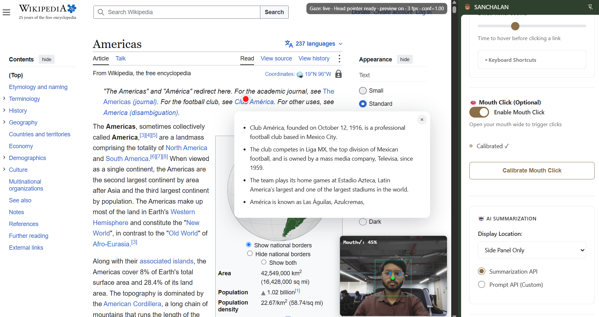

# 🥜 SANCHALAN

> **Hands-free browsing powered by head tracking and Chrome Built-in AI**

SANCHALAN makes the web accessible to everyone by combining computer vision-based head tracking with Chrome's Built-in AI to enable completely hands-free browsing and instant link summaries.



---

## 🏆 Built for Hacktoberfest HackDay Bengaluru 2026

SANCHALAN showcases the power of **Chrome's Built-in AI APIs** by bringing sophisticated, privacy-first accessibility directly into the browser. This project demonstrates real-world application of on-device AI to solve critical accessibility challenges.

### 🎯 Chrome AI Features Utilized

#### **1. Summarizer API** ⭐ Primary Feature
- **Streaming summarization** with `summarizeStreaming()` for real-time updates
- Configurable summary types: `key-points`, `tl;dr`, `teaser`, `headline`
- Markdown-formatted output with adjustable length
- **100% on-device processing** with Gemini Nano

**Implementation Highlight:**
```javascript
const summarizer = await ai.summarizer.create({
  type: 'key-points',
  format: 'markdown',
  length: 'medium',
  sharedContext: 'This is an article from a webpage.',
  outputLanguage: 'en'
});

const stream = summarizer.summarizeStreaming(processedText);
for await (const chunk of stream) {
  // Real-time UI updates as summary generates
  updateTooltip(chunk);
}
```

#### **2. Prompt API** ⭐ Advanced Custom Prompting
- **Specialized content processing** for YouTube
- Custom system prompts for context-aware summarization
- Streaming responses with `promptStreaming()`

**Example - YouTube Video Summaries:**
```javascript
const session = await ai.languageModel.create({
  expectedOutputs: [{ type: 'text', languages: ['en'] }]
});

const prompt = `Analyze this YouTube video and create a structured summary:

TRANSCRIPT: ${captionText}
DESCRIPTION: ${videoDescription}

Provide: Main theme, key points (3-5 bullets), important timestamps`;

const stream = session.promptStreaming(prompt);
```

### 🌟 Why Chrome Built-in AI?

**Privacy by Design:**
- ✅ Zero data sent to external servers
- ✅ Camera feed processed locally with Human.js
- ✅ AI runs entirely in browser with Gemini Nano
- ✅ Perfect for users with disabilities who need privacy-respecting tools

**Accessibility at Scale:**
- ✅ No expensive hardware ($0 vs. $10,000+ for eye-gaze systems)
- ✅ No cloud API costs
- ✅ Instant responses (no network latency)
- ✅ Works offline after model download
- ✅ Democratizes assistive technology

---

## 🌟 The Problem

For millions of people with mobility impairments, ALS, cerebral palsy, RSI, or temporary disabilities, using a traditional mouse and keyboard is painful, difficult, or impossible. Existing assistive technologies often:
- Cost $10,000+ for eye-gaze systems
- Require specialized hardware and setup
- Send data to cloud servers (privacy concerns)
- Don't work in web browsers

Meanwhile, browsing the web means clicking countless links just to preview content—creating friction for everyone, especially users relying on alternative input methods.

---

## 💡 The Solution

**SANCHALAN** solves both problems with two powerful features:

### 1. 🎯 Complete Hands-Free Control

**Head Tracking:**
- Look left/right → cursor moves horizontally
- Tilt up/down → cursor moves vertically
- Uses One-Euro filter for smooth, jitter-free movement
- Personalized calibration adapts to your natural range

### 2. 🎙️ Privacy-Aware Voice Interaction & Deterministic Commands

**Voice Typing & Dictation:**
- Transcribes speech and injects final text directly at the cursor of the active text field.
- Deterministic spoken punctuation formatting ("period", "comma", "question mark", "new line", "new paragraph").
- **Tolerant Stop Detection:** "Stop dictation", "stop typing", "end dictation", "finish dictation", and "stop voice typing" stop dictation immediately even when the wake word is omitted. Ordinary speech containing the word "stop" does not trigger accidental stops.
- Safe fallback: If no text field is focused, displays an in-page HUD and preserves the transcript safely in the side panel with one-click copy.
- Never injects interim transcripts into page content.

**Deterministic Voice Commands:**
- Hands-free browser navigation with strict allowlist matching (no LLM decision-making for privileged actions).
- Dual Arming: Say the wake phrase ("sanchalan" and phonetic ASR variants like "sanchaalan", "sun chalan") or hold mouth open for 900ms (face gesture).
- Short rolling transcript window handles split recognition events (e.g. "sanchalan" followed by "stop dictation" or a command).
- 5-second listening window with in-page HUD and side-panel countdown indicator.
- Supported commands:
  - **Navigation:**
    - `next tab` / `previous tab`
    - `switch to tab <number>` (e.g. "switch to tab 2", "switch to tab two")
    - `switch to tab <title>` (e.g. "switch to tab github", "switch to tab chat", "switch to tab new york times") — uses 6-tier ranked matching in the current window.
    - `choose <1-5>` (e.g. "sanchalan choose 1", "choose 2") to select numbered candidates when multiple tabs match.
    - `close current tab` (requires explicit "confirm close" confirmation)
    - `new tab` / `reload tab`
    - `go back` / `go forward`
  - **Editing & Clipboard:**
    - `copy` / `copy selected text`
    - `cut` / `cut selected text` (requires confirmation: "confirm cut" to prevent accidental data loss)
    - `paste` / `paste text` (uses `navigator.clipboard` with an extension-local clipboard fallback in session memory)
    - `select all`
    - `undo` / `redo`
  - **YouTube:**
    - `open youtube` / `open youtube dot com`
    - `search in youtube <query>` / `search youtube for <query>` (navigates active or existing YouTube tab, or opens a new tab with encoded query)
  - **Dictation & Control:**
    - `start dictation` / `stop dictation`
    - `stop listening` / `cancel`

**Deliberate Facial & Head Gestures (Optional):**
- Configurable in side-panel settings:
  - Sustained mouth-open hold (900ms) → arm voice commands.
  - Optional deliberate head pose (tilt left, nod up, turn left) → copy selected text.
  - Optional deliberate head pose (tilt right, nod down, turn right) → paste text.
- Cooldowns and click suppression ensure gestures never trigger unwanted mouth clicks.


**Mouth-Open Clicking:**
- Open mouth → triggers click
- Calibrated to your facial structure
- 800ms cooldown prevents accidental double-clicks
- Real-time visual feedback

**Dwell-Based Interaction:**
- Hover on links → automatic activation
- Visual progress indicator (growing ring)
- Magnetic snapping to nearby clickables (45px radius)
- Configurable timing (300-1500ms)

**Smart Navigation Zones:**
- Look top/bottom → auto-scroll (180px zones)
- Look left edge → browser back (80px zone)
- Look right edge → browser forward (80px zone)
- Colored visual feedback shows active zones

### 2. 🤖 AI-Powered Link Previews

**Chrome's Built-in AI** generates instant summaries for:
- 📄 **Web articles** - Clean, concise key points
- 🎥 **YouTube videos** - Summarized from captions + description

**Special Feature: YouTube Caption Extraction**
- Intercepts XHR requests for captions
- Supports JSON3 (new) and XML (legacy) formats
- Combines transcript + description for better context
- All processed on-device by Gemini Nano

**No cloud, no data collection, just pure private accessibility.**

---

## ✨ Key Features

### Hands-Free Control
- 🎯 **Head tracking** cursor control (no hands required)
- 👄 **Mouth-open clicking** with calibration
- ⏱️ **Dwell activation** (hover to click)
- 🧲 **Magnetic snapping** helps target links
- 📜 **Auto-scrolling** zones (top/bottom)
- ⬅️➡️ **Browser navigation** zones (left/right edges)

### AI Summaries
- 🤖 **On-device AI** (Gemini Nano via Chrome)
- 📺 **YouTube caption** extraction & summarization
- ⚡ **Real-time streaming** updates
- 💾 **Smart caching** (30-minute retention)
- 🎨 **Dual display** (tooltip + side panel)

### Customization
- 🎚️ **Adjustable dwell time** (300-1500ms)
- 🎯 **Head calibration** (5-point personalization)
- 👄 **Mouth calibration** (adaptive thresholds)
- 🎨 **Display modes** (tooltip, panel, or both)
- ⚙️ **API choice** (Summarizer or custom Prompt)

### Privacy & Performance
- 🔒 **100% local processing** (no external servers)
- 📷 **Webcam-based** (any standard camera)
- ⚡ **GPU-accelerated** tracking (WebGL)
- 🎯 **Lightweight** (~2MB extension)

---

## 🚀 Installation

### Prerequisites

1. **Chrome Dev or Canary** (version 128+)
   - Download: [Chrome Dev](https://www.google.com/chrome/dev/) or [Chrome Canary](https://www.google.com/chrome/canary/)

2. **Enable Chrome AI Flags:**
   - Navigate to `chrome://flags/#optimization-guide-on-device-model`
   - Set to **"Enabled BypassPerfRequirement"**
   - Navigate to `chrome://flags/#prompt-api-for-gemini-nano`
   - Set to **"Enabled"**
   - Navigate to `chrome://flags/#summarization-api-for-gemini-nano`
   - Set to **"Enabled"**
   - **Restart Chrome**

3. **Verify Model Download:**
   - Open DevTools Console (F12)
   - Run: `await ai.summarizer.availability()`
   - Should return `"readily"` or `"available"`
   - If `"downloadable"`, wait 5-10 minutes for model download

### Install Extension

1. **Clone repository:**
   ```bash
   git clone https://github.com/Anshul-Kumar35/SANCHALAN.git
   cd SANCHALAN
   ```

2. **Load extension:**
   - Open `chrome://extensions/`
   - Enable **"Developer mode"** (toggle top-right)
   - Click **"Load unpacked"**
   - Select the repository folder

3. **Grant permissions:**
   - Click SANCHALAN icon in toolbar
   - Allow camera access when prompted
   - Wait for models to load (~5-10 seconds)

---

## 🎮 How to Use

### First-Time Setup

#### 1. **Enable Head Tracking**
- Open SANCHALAN side panel (click extension icon)
- Toggle **"Enable Head Tracking"**
- Grant camera permission
- Wait for face detection models to load

#### 2. **Calibrate Head Control**
- Click **"Calibrate Head Tracking"** (or press `Alt+H`)
- Follow 5-point calibration:
  1. Look at CENTER → press SPACE
  2. Look LEFT → press SPACE
  3. Look RIGHT → press SPACE
  4. Look UP → press SPACE
  5. Look DOWN → press SPACE
- Cursor now follows your head! 🎉

#### 3. **Calibrate Mouth Clicking** (Optional)
- Toggle **"Enable Mouth Click"**
- Click **"Calibrate Mouth Click"** (or press `Alt+M`)
- Keep mouth closed when prompted
- Open mouth wide when prompted
- Test by opening mouth to click

### Daily Usage

1. **Navigate** - Move head to control cursor
2. **Preview links** - Hover over any link for 600ms
3. **Click** - Open mouth OR dwell on buttons/links
4. **Scroll** - Look at top (scroll up) or bottom (scroll down)
5. **Navigate** - Look at left edge (back) or right edge (forward)

### Keyboard Shortcuts

| Shortcut | Action |
|----------|--------|
| `Alt+H` | Calibrate head tracking |
| `Alt+M` | Calibrate mouth clicking |
| `Esc` | Cancel active summary |

---

## 🛠️ Technical Architecture

### Tech Stack

#### Computer Vision
- **[Human.js](https://github.com/vladmandic/human)** - 468-point facial landmark detection
- **One-Euro Filter** - Jitter elimination (fc=0.4, β=0.0025)
- **Adaptive Smoothing** - Lerp interpolation (0.06 center, 0.10 edge)
- **WebGL Acceleration** - GPU-based processing

#### AI Integration
- **Chrome Summarizer API** - Key-point extraction, markdown formatting
- **Chrome Prompt API** - Custom prompting for specialized content
- **Gemini Nano** - On-device language model
- **Streaming Responses** - Real-time character-by-character updates

#### Content Extraction
- **Readability.js** - Mozilla's article extraction
- **XHR Interception** - YouTube caption capture
- **Smart Truncation** - Beginning/middle/end preservation for long content

#### Browser Integration
- **Manifest V3** - Modern extension architecture
- **Side Panel API** - Dedicated control interface
- **Content Scripts** - Page interaction & tooltip rendering
- **Background Service Worker** - AI processing & job management

### How It Works

#### Head Tracking Pipeline
```
Webcam Feed → Human.js (Face Detection) → Facial Landmarks (468 points)
→ Head Pose Estimation (pitch/yaw) → One-Euro Filter (smoothing)
→ Screen Coordinates → Mouse Events → Dwell Detection → Action
```

#### AI Summary Pipeline
```
Link Hover (600ms) → Fetch Page HTML → Readability.js (Extract Content)
→ Smart Truncation (fit context) → Chrome Summarizer/Prompt API
→ Gemini Nano Processing → Streaming Response → Tooltip Display
```

#### YouTube Special Pipeline
```
Page Load → Inject XHR Interceptor → Monitor Network Requests
→ Capture Caption Response (JSON/XML) → Parse Timestamps & Text
→ Combine with Video Description → Custom Prompt API Call
→ Structured Summary → Display
```

---

## 📁 Project Structure

```
SANCHALAN/
├── manifest.json              # Extension config (MV3)
├── background.js              # AI processing, job management
├── content.js                 # Link detection, tooltips
├── sidepanel.js/.html         # Settings UI
│
├── gaze/                      # Head tracking system
│   ├── gaze-core.js           # Computer vision, Human.js
│   ├── gaze-dwell.js          # Dwell detection, interaction
│   ├── gaze-overlay.js        # Visual feedback (zones)
│   ├── head-cal.js            # Head calibration
│   ├── mouth-cal.js           # Mouth click calibration
│   └── human/                 # Human.js + TensorFlow models
│
├── youtube/                   # YouTube features
│   ├── youtube-caption-handler.js    # XHR interception
│   └── youtube-content-bridge.js     # Content script bridge
│
├── twitter/                   # Twitter/X integration
│   └── twitter-interceptor.js        # GraphQL interception
│
├── lib/                       # Third-party libraries
│   └── Readability.js         # Mozilla content extraction
│
└── icons/                     # Extension icons
```

---

## 🧪 Development

### Debug Mode

Enable logging in respective files:
- `content.js`: `const DEBUG_ENABLED = true`
- `gaze-dwell.js`: `const DEBUG_DWELL = true`

### Test Chrome AI APIs

Open DevTools console on any page:

```javascript
// Check Summarizer API
const summarizerStatus = await ai.summarizer.availability();
console.log('Summarizer:', summarizerStatus);

// Check Prompt API
const promptStatus = await ai.languageModel.availability();
console.log('Prompt API:', promptStatus);

// Test summarization
if (summarizerStatus === 'readily') {
  const summarizer = await ai.summarizer.create({
    type: 'key-points',
    format: 'markdown',
    length: 'short'
  });

  const result = await summarizer.summarize('Your text here...');
  console.log(result);
}
```

### Performance Monitoring

Check browser console for:
- Frame processing times (target: 30fps)
- AI streaming latency
- Cache hit rates
- Job abort reasons

---

## 🐛 Troubleshooting

### AI Not Working
- ✅ Verify Chrome flags enabled (see Installation)
- ✅ Check API status: `await ai.summarizer.availability()`
- ✅ Wait for model download (~5 min first time)
- ✅ Restart Chrome after enabling flags

### Head Tracking Issues
- ✅ Good lighting (front-facing light works best)
- ✅ Camera permissions granted
- ✅ Recalibrate if cursor feels off
- ✅ Keep torso stable, move head not body

### Cursor Jittery
- ✅ Recalibrate head tracking
- ✅ Improve lighting conditions
- ✅ Ensure stable seated position
- ✅ Adjust `HEAD_FILTER_MIN_CUTOFF` in `gaze-core.js`

### Mouth Clicks Not Working
- ✅ Recalibrate mouth detection
- ✅ Ensure camera sees mouth clearly
- ✅ Toggle "Enable Mouth Click" on
- ✅ Exaggerate opening during calibration

---

## 📊 Technical Specifications

| Feature | Specification |
|---------|--------------|
| **AI Model** | Gemini Nano (Chrome Built-in) |
| **Face Detection** | 468-point facial landmarks (Human.js) |
| **Signal Filter** | One-Euro (fc=0.4, β=0.0025, d_cutoff=1.0) |
| **Smoothing** | Adaptive lerp (0.06 center, 0.10 edge) |
| **Dwell Time** | 600ms default (300-1500ms range) |
| **Click Cooldown** | 800ms (mouth-open) |
| **Snap Radius** | 45px magnetic targeting |
| **Scroll Zones** | 180px top/bottom edges |
| **Nav Zones** | 80px left/right edges |
| **Cache TTL** | 30 minutes |
| **Max Content** | 4000 chars (Summarizer), 3000 chars (Prompt) |

---

## 🌍 Use Cases

### Accessibility
- ♿ Users with mobility impairments (paralysis, ALS, cerebral palsy)
- 🤕 Repetitive strain injury (RSI) prevention/management
- 🩹 Temporary disabilities (broken arm, surgery recovery)
- 🧠 Alternative input for motor control challenges

### Productivity
- 📝 Hands-free research while taking notes
- 🍕 Browse while eating or multitasking
- 💻 Second screen setups
- ⚡ Quick link previews without navigation

### Research & Learning
- 📚 Wikipedia exploration
- 📄 Academic paper browsing
- 📰 News aggregation
- 🎓 Topic learning with previews

---

## 🎙️ Voice Interaction Subsystem Architecture (Stage 1)

### Architecture & Data Flow
In Manifest V3 (MV3), service workers do not have DOM or audio capture access. SANCHALAN uses a secure, decoupled MV3 architecture:

```
[Microphone Hardware]
        │
        ▼ getUserMedia({ audio: true })
[Offscreen Document: voice/offscreen.html & offscreen.js]
        │ (Owns Audio Stream & SpeechRecognition Engine)
        │
        ├── VOICE_INTERIM_TRANSCRIPT (preview only) ──► [Side Panel]
        └── VOICE_FINAL_TRANSCRIPT ───────────────────► [Background Service Worker]
                                                                │
                                            (Single Source of Truth: State Machine)
                                            ['disabled'|'idle'|'armed'|'dictating'|'processing-command'|'error']
                                                                │
                                ┌───────────────────────────────┴───────────────────────────────┐
                                ▼                                                               ▼
                     [Deterministic Command Parser]                                    [Active Tab: content.js]
                      (Next/Prev/Switch/Close/Dictate)                                  - Caret Text Insertion
                                                                                        - DOM Events ('input', 'change')
                                                                                        - Floating HUD Indicator
                                                                                        - Fallback toast + side-panel copy
```

### Privacy & Security Boundaries
- **No Client-Side API Keys:** Client-side extension storage, manifest files, and repository source code must never contain API keys.
- **Audio Privacy:** Audio capture occurs exclusively inside the local offscreen document. No raw audio data is dispatched to external servers in Stage 1.
- **Deterministic Command Execution:** Privileged browser actions (tab switching, closing, reload, navigation) are strictly parsed through an allowlist parser (`voice/command-parser.js`). An LLM is never used to decide privileged browser actions.

### STT Provider Interfaces & Tradeoffs
1. **`WebSpeechProvider` (Stage 1 Working Provider):**
   - *Status:* Active for local development, testing, and live demonstrations.
   - *Tradeoffs:* Uses browser-provided `SpeechRecognition`. Zero setup required, but depends on browser/OS platform capabilities and does not guarantee offline processing.
2. **`SarvamProvider` (Stage 2 Placeholder):**
   - *Status:* Clean interface & settings placeholder; disabled until configured.
   - *Architecture:* Must communicate through a secure backend proxy URL. Direct client-side API keys are strictly forbidden.
   - *Note:* Sarvam AI is a proprietary cloud/edge speech recognition service optimized for Indian languages; it is not claimed to be fully local or open source.
3. **`LocalWhisperProvider` (Stage 2 Placeholder):**
   - *Status:* Clean interface & settings placeholder; disabled until configured.
   - *Architecture:* Calls a configurable localhost companion service (e.g., `http://localhost:8080/v1/transcribe` via `whisper.cpp` or `faster-whisper`).
   - *Advantage:* Complete on-device privacy and offline capability without bundling multi-gigabyte models into the Chrome extension bundle.

### Permissions Rationale
- `"offscreen"`: Required by Chrome Manifest V3 to host an offscreen document with `chrome.offscreen.Reason.USER_MEDIA` for microphone capture and speech recognition.
- `"clipboardRead"`: Required to support the hands-free voice command `"paste"`, allowing clipboard contents to be inserted into the active text element without blocking prompts.
- `"clipboardWrite"`: Required to support the voice command `"copy selected text"`, placing the active selection onto the system clipboard.
- *Host Permissions:* No additional host permissions were added beyond existing requirements.

### Known Limitations & Security Boundaries
- **Chrome Internal Pages:** Browser security policies prevent extensions from injecting content scripts or executing DOM actions (such as copy, cut, paste, typing, or history navigation) on `chrome://`, `chrome-extension://`, `edge://`, `about:`, or `devtools://` pages. On these system pages, SANCHALAN returns a graceful status message advising the user to focus a standard web page.
- **System Clipboard Permissions:** When pasting text in web pages, modern browsers require explicit user gesture activation or clipboard permissions. SANCHALAN automatically falls back to its extension-local session clipboard memory (`chrome.storage.session`) if `navigator.clipboard.readText()` is denied or unavailable.


---

## 🙏 Acknowledgments

Built with amazing open-source tools:
- **[Human.js](https://github.com/vladmandic/human)** by Vladimir Mandic - Face tracking
- **[Readability.js](https://github.com/mozilla/readability)** by Mozilla - Content extraction
- **Chrome Built-in AI** by Google - On-device AI with Gemini Nano
- **One-Euro Filter** by Géry Casiez - Signal smoothing algorithm

---

## 🤝 Contributing

Built for the Chrome Built-in AI Hackathon! Contributions welcome:

1. Fork the repository
2. Create feature branch (`git checkout -b feature/amazing-feature`)
3. Commit changes (`git commit -m 'Add amazing feature'`)
4. Push branch (`git push origin feature/amazing-feature`)
5. Open Pull Request

---

## 🔗 Resources

- [Chrome Built-in AI Documentation](https://developer.chrome.com/docs/ai/built-in)
- [Gemini Nano Information](https://deepmind.google/technologies/gemini/nano/)
- [Human.js GitHub](https://github.com/vladmandic/human)
- [Web Accessibility Guidelines](https://www.w3.org/WAI/standards-guidelines/)

---

<div align="center">

**Made with ❤️ for Hacktoberfest Hackday Bengaluru**

*Empowering digital independence through on-device AI*

🥜 *SANCHALAN: Hands-free digital independence for motor disabilities.*

</div>
